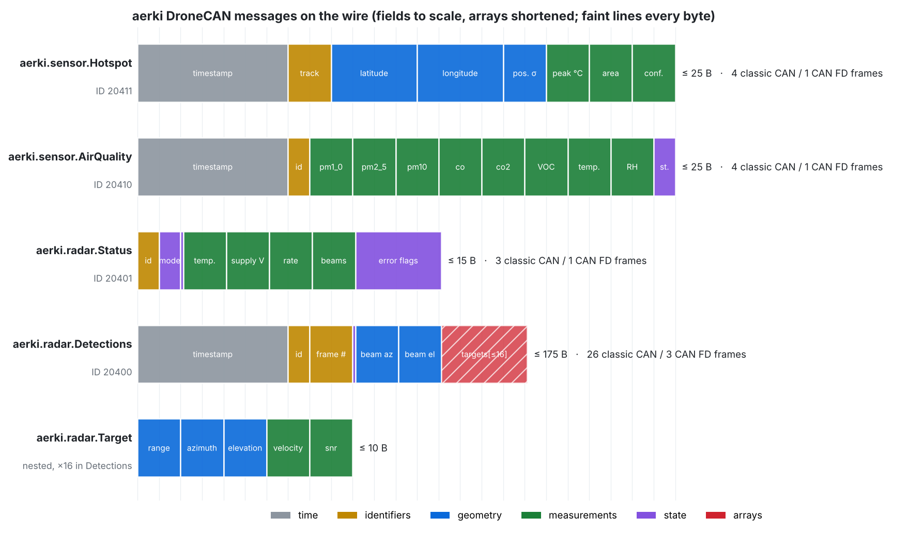

# dronecan-dsdl

The DroneCAN message definitions shared by every AERKI device: radar, payload sensors and the flight controller.
One source of truth, validated against the full DroneCAN ecosystem on every commit.

[](https://github.com/aerki-space/dronecan-dsdl/actions/workflows/ci.yml)



## Types

| Type | ID | Purpose |
|---|---|---|
| `aerki.radar.Detections` | 20400 | Up to 16 radar targets per frame: range, azimuth, elevation, radial velocity, SNR |
| `aerki.radar.Status` | 20401 | Radar mode, transmitter state, temperature, supply, frame rate |
| `aerki.radar.SetBeam` | 230 (service) | Standby, hold a beam direction, or resume scanning |
| `aerki.sensor.AirQuality` | 20410 | Particulates, CO, CO₂, VOC index, temperature and humidity from an air-quality payload |
| `aerki.sensor.Hotspot` | 20411 | A thermal hotspot already projected to the ground, with uncertainty and confidence |

Full field-by-field definitions: [docs/types.md](docs/types.md) (generated from the sources).

## Designed for the bus

- **Compact numbers:** measurements are `float16`, which keeps every sensor message in a single CAN FD frame.
  Positions use `int32` degrees × 10⁷ (about 1 cm), the same convention as MAVLink positions.
- **One message, one observation:** a hotspot or an air sample travels with its own timestamp and uncertainty, so a
  receiver never has to pair messages up.
- **Radar sized for CAN FD:** a full 16-target frame is 3 CAN FD frames, against 26 on classic CAN. At 20 Hz that's
  about 1 % of a CAN FD bus (see the
  [flight controller's bus-load study](https://github.com/aerki-space/AI-Flight-Controller#bus-load)).

## What's checked on every commit

- **No ID collisions:** the definitions are parsed together with every namespace that ships with the DroneCAN
  tools: the standard set, the ArduPilot set and the known vendor sets.
- **ID ranges:** every ID stays inside the ranges allocated in [docs/id-allocation.md](docs/id-allocation.md).
- **Round trips:** every type is encoded into real DroneCAN frames, on both classic CAN and CAN FD, then decoded
  and compared.
- **Generated docs:** the generated documentation matches the sources.

## Use it

```sh
pip install -r requirements.txt
python3 tools/validate.py                 # IDs, sizes, signatures
python3 -m unittest discover -s tests     # round trips
pip install matplotlib && python3 tools/plot_layout.py   # redraw docs/img/layout.png
```

Integration with ArduPilot, PX4, the DroneCAN GUI tool, Python and C firmware: [docs/usage.md](docs/usage.md).

## Layout

```
aerki/
  radar/     radar messages and services
  sensor/    payload sensor messages
docs/        ID allocation, usage, generated type reference
tools/       validate.py, gen_docs.py, plot_layout.py
tests/       round-trip and rule checks
```

## License

MIT, see [LICENSE](LICENSE).
